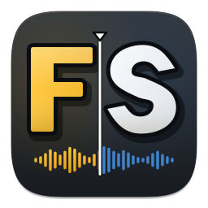
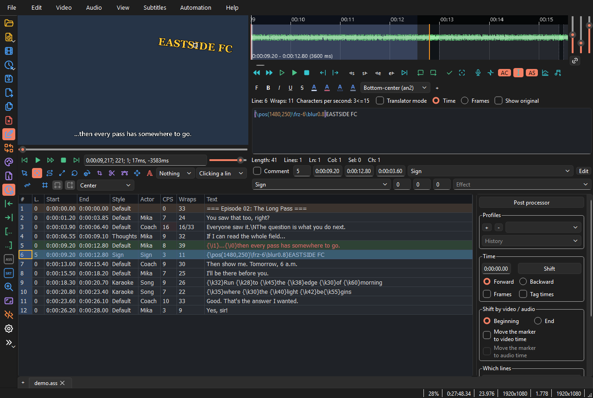

<div align="center">



# FS Editor

**A fast, cross-platform ASS/SSA subtitle editor for typesetting, timing and translation.**<br>
Aegisub's logic and Automation 4 scripts, Kainote's layout and workflow.

[](https://github.com/Ognisty321/fs-editor/actions/workflows/ci.yml)
[](https://github.com/Ognisty321/fs-editor/releases/latest)
[](LICENSE)


[Download](#download) • [Features](#features) • [Usage](#usage) • [Building from source](#building-from-source) • [Documentation](#documentation)



</div>

FS Editor is a subtitle editor built for fansub and professional workflows. Its core is written in Rust and knows nothing about the GUI: the Qt interface, the `fsed` command-line tool and Lua scripts all run the same document operations. A file that is opened and saved without edits comes out byte-for-byte identical.

- **Aegisub-compatible.** Timing math, ASS handling and the Automation 4 Lua API follow Aegisub, so existing macros, `karaskel`, `kara-templater` and DependencyControl scripts run unchanged.
- **Kainote-style workspace.** Grid, edit box, shift-times panel, translation mode and default shortcuts follow Kainote, re-engineered from its behaviour rather than its code.
- **Built for big files.** Tens of thousands of lines, heavy `\p` drawings and long-running scripts without freezing the window; video and audio are drawn on the GPU.

> [!NOTE]
> FS Editor is in early development (0.1.x). Windows and Linux builds are produced and smoke-tested by CI for every release. The code is written with macOS in mind, but no macOS build has been made or tested yet.

## Download

Grab the ZIP for your system from the [latest release](https://github.com/Ognisty321/fs-editor/releases/latest):

| Package | System |
|---|---|
| `FS-Editor-<version>-windows-x64.zip` | Windows 10/11, 64-bit |
| `FS-Editor-<version>-linux-x64.zip` | Linux x86-64 (built on Ubuntu 24.04) |

Releases up to 0.1.2 name them `FS-Editor-<version>-win64.zip` and `FS-Editor-<version>-Linux.zip`.

Unpack it anywhere and run `bin\fsed.exe` (Windows) or `bin/fsed` (Linux). There is no installer and nothing else to install: Qt, FFmpeg, libass, the Aegisub automation scripts, and Polish and English dictionaries and thesauri are all included. Verify the download against `SHA256SUMS.txt` from the same release.

> [!TIP]
> To hear about new versions, use **Help → Check for updates**, or enable the daily check in the settings. The program itself never contacts the network unless you turn that on (scripts such as DependencyControl may).

## Features

- **Lossless ASS.** BOM, line endings, comments, unknown sections, `[Fonts]`, `[Graphics]` and Aegisub project data survive untouched; an unedited line is written back from its original text.
- **Formats.** ASS, SSA, SRT, WebVTT, MPL2, MicroDVD, TMP and TTXT, with encoding detection (UTF-8, UTF-16, Windows-1250 and others); export to EBU STL, Adobe Encore and TranStation.
- **Frame-accurate video.** BestSource decoding, VFR (v1 and v2 timecodes), keyframes, chapters, libass preview, zoom, player mode, dummy video, a detachable video window with an overscan mask, and saving or copying frames with or without subtitles. Colour conversion runs in shaders.
- **AviSynth and VapourSynth.** `.avs` and `.vpy` scripts open as video and audio when AviSynth+ or VapourSynth is installed; the libraries load only on first use.
- **Audio.** GPU waveform and spectrogram, karaoke mode, playback and export of a selection to WAV.
- **Visual typesetting.** `\pos`, `\move`, `\org`, `\clip`/`\iclip`, `\p` drawings, scaling and rotation directly on the video, plus an all-tags tool and positioning or scaling by a rectangle.
- **Timing.** Drag times in the grid, Kainote's shift-times panel, the timing post-processor (lead-in/out, adjacent line linking, keyframe snapping), kanji timer, FPS change and resolution resampling.
- **Translation and QC.** Kainote's translation mode (two text fields, an original-text column, aligning the translation to the original), translation and styling assistants, line filters (comments, untranslated, by style, hidden lines) and "Correct minor errors".
- **Automation.** Aegisub Automation 4 scripts in Lua and MoonScript, running on LuaJIT.
- **Everyday tools.** Style manager, font collector (including MKV attachments), attachments, Hunspell spell checking with thesaurus, find and replace, line selection, comparing two tabs, history, autosave and sessions.
- **Tabs.** Each file has its own document, video, audio and undo history; two tabs can be shown side by side.
- **Customisable.** English and Polish UI, colour themes, a hotkey editor and file associations.

## Usage

### Editor

```bash
fsed subs.ass video.mkv
```

Files passed on the command line open in a tab. Subtitles, video, audio and keyframes can also be dropped anywhere on the window. A video with text subtitle tracks (ASS, SSA, SRT) opened in an empty tab offers to load one of them.

<details>
<summary><b>AviSynth and VapourSynth scripts</b></summary>

`.avs` and `.vpy` files open like any video: from the menu, by drag and drop, on the command line and in `fsed media`. The same script can also be opened as audio.

- AviSynth needs the 64-bit [AviSynth+](https://github.com/AviSynth/AviSynthPlus) (`avisynth.dll` in the system folder or next to the program; `libavisynth` on Linux).
- VapourSynth needs [VapourSynth](https://www.vapoursynth.com) R55 or newer with Python. The VSScript library is found automatically (`VSSCRIPT_PATH`, the registry, Python on `PATH`) or can be set in the video settings. A script can provide keyframes in `__aegi_keyframes` and frame times in `__aegi_timecodes`.
- The AviSynth options match Aegisub's: memory limit, support for versions older than 2.6, down-mixer and forced audio sample rate.

**A script is a program** and runs with the editor's permissions: only open scripts you trust.

</details>

<details>
<summary><b>Spell checking and thesaurus</b></summary>

Spell checking uses Hunspell dictionaries (`xx_YY.aff` + `xx_YY.dic`) and synonyms come from MyThes thesauri (`th_xx_YY*.idx` + `.dat`). Release packages ship Polish and English dictionaries in `bin/dictionaries/`. Drop other languages into that folder, or point the settings at another folder and language. Up-to-date sources: Polish from [sjp.pl](https://sjp.pl/sl/en/), English from [en-wl/wordlist](https://github.com/en-wl/wordlist/releases).

</details>

### Command line

`fsed` also runs core operations without the GUI:

```bash
# delay everything after 10 minutes by 1.2 s
fsed shift ep01.ass --by 1.2s --after 0:10:00.00 --in-place

# convert to SRT in Windows-1250
fsed convert ep01.ass -o ep01.srt --out-encoding windows-1250 --no-bom

# lines above 20 characters per second, tags stripped
fsed lines ep01.ass --dialogue --min-cps 20 --strip

# run kara-templater over a whole file
fsed lua crates/fs-automation/automation/autoload/kara-templater.lua kara.ass --macro "Apply karaoke template" -o kara-fx.ass
```

See [docs/CLI.md](docs/CLI.md) for every command (`info`, `check`, `fonts`, `resample`, `postprocess`, `tl`, `media` and more).

## Building from source

| Tool | Needed for |
|---|---|
| Rust 1.99 (installed by `rustup` from [rust-toolchain.toml](rust-toolchain.toml)) | everything |
| A C/C++ compiler: MSVC, GCC or Clang | LuaJIT, media and GUI |
| [vcpkg](https://vcpkg.io) (`VCPKG_ROOT`, or the copy bundled with Visual Studio) | video and audio |
| Qt 6.8+ with Qt Shader Tools, CMake 3.28+ | GUI |

On Linux, vcpkg and ALSA also need system packages (Ubuntu):

```bash
sudo apt-get install -y libasound2-dev ninja-build nasm libgl1-mesa-dev libxkbcommon-dev autoconf-archive bison flex gperf zip
```

> [!IMPORTANT]
> On Windows, the `NoDefaultCurrentDirectoryInExePath` environment variable breaks the LuaJIT build, because `msvcbuild.bat` runs `minilua` from the current directory. Unset it for the build, e.g. `env -u NoDefaultCurrentDirectoryInExePath cargo build`.

### 1. Core and CLI

The core and `fsed` need only Rust and a C compiler:

```bash
git clone https://github.com/Ognisty321/fs-editor.git
```

```bash
cd fs-editor && cargo build --release -p fs-cli
```

The binary is written to `target/release/fsed`.

### 2. Media libraries

FFmpeg, libass and BestSource are installed from [vcpkg.json](vcpkg.json) by a script that records their location in `.cargo/config.toml` (for cargo) and prints the directory to pass to CMake as `FS_DEPS_DIR`.

Windows:

```bash
pwsh tools/deps.ps1
```

Linux and macOS (requires `VCPKG_ROOT`):

```bash
TRIPLET=x64-linux-dynamic tools/deps.sh
```

The libraries go outside the repository (`%LOCALAPPDATA%\fs-editor\deps` or `~/.cache/fs-editor/deps`) because vcpkg's FFmpeg port cannot handle spaces in paths.

With the media libraries in place, build the CLI with the `media` feature to get the `fsed media` commands:

```bash
cargo build --release -p fs-cli --features media
```

### 3. GUI

CMake builds the GUI and pulls in the Rust core through Corrosion. Pass the Qt location and the libraries from step 2 at configure time.

Windows (Visual Studio 2026):

```bash
cmake -S app --preset windows -DCMAKE_PREFIX_PATH=C:/Qt/6.12.0/msvc2022_64 -DFS_DEPS_DIR="$LOCALAPPDATA/fs-editor/deps/installed/x64-windows"
```

```bash
cmake --build app/build-windows --config Release
```

Linux (CI builds on Ubuntu 24.04; also tested on 26.04 with GCC and Qt 6.12 from aqtinstall) and macOS:

```bash
cmake -S app --preset unix -DCMAKE_PREFIX_PATH=$HOME/Qt/6.12.0/gcc_64 -DFS_DEPS_DIR=$HOME/.cache/fs-editor/deps/installed/x64-linux-dynamic
```

```bash
cmake --build app/build-unix
```

The `windows-dev` preset builds the core with the `gui-dev` cargo profile (no LTO, incremental), which makes rebuilds during GUI work much faster.

### 4. ZIP package

CPack assembles the program, Qt, the media libraries and the bundled automation scripts into a ZIP. To include the Polish and English dictionaries and thesauri as the release packages do, fetch them first and add `-DFS_DICTIONARIES_DIR=<folder>` to the configure command from step 3:

```bash
python tools/dictionaries.py ../dictionaries
```

Then package on Windows or Linux:

```bash
cd app/build-windows && cpack -C Release
```

```bash
cd app/build-unix && cpack
```

On Linux the package uses the RUNPATH `$ORIGIN/../lib`; the only system libraries it needs are the X11/xcb ones Qt requires (`libxcb-cursor0`, `libxkbcommon-x11-0` and friends), present on any desktop install.

## Testing

```bash
cargo test
```

The default run covers every crate that does not need the media libraries. After [step 2](#2-media-libraries), the media and bridge tests can run too:

```bash
cargo test -p fs-media -p fs-bridge
```

Corpus tests check every file for byte-exact round-trips, untouched neighbouring fields on edit, lossless tag parsing and conversion through SRT, MPL2, MicroDVD, TMP and SSA. Files come from [`tests/corpus/`](tests/corpus/README.md) (Aegisub's test scripts, VFR timecodes, keyframes and encoding samples) and from your own files in the git-ignored `tests/corpus-local/`; the round-trip tests also read the directory in `FS_CORPUS_DIR`.

<details>
<summary><b>Optional tests and test media</b></summary>

| Variable | Enables |
|---|---|
| `FS_DEPCTRL_DIR=/path/to/DependencyControl` | DependencyControl compatibility test (`cargo test -p fs-automation dependency_control`) |
| `FS_DICT=/path/pl_PL`, `FS_DICT_EN=/path/en_US` | spell-check tests on real dictionaries (`cargo test -p fs-bridge spell`), paths without extension |

The media in `tests/media` are generated by `tools/gen-test-media.sh` (needs ffmpeg with libx264 and mkvmerge). Every frame is a flat grey whose brightness encodes the frame number, so tests check seek accuracy from a single pixel.

Video decoding speed (frames per second to RGBA, as the window takes them) is measured by the `decode_speed` test:

```bash
FS_BENCH_VIDEO=film.mkv cargo test -p fs-media --release decode_speed -- --ignored --nocapture
```

</details>

<details>
<summary><b>GUI smoke tests</b></summary>

The GUI reads environment variables that let it be tested without user input. Smoke runs use their own settings ("FS Editor smoke test"), so your configuration is left alone. The main variables (the full set is read in `app/src/main.cpp`):

| Variable | Effect |
|---|---|
| `FSED_SMOKE=file.png` | saves a screenshot of the window (or of the open dialog) and exits |
| `FSED_SMOKE_MS` | time before the screenshot in ms (default 1000) |
| `FSED_SMOKE_ROW=N` | selects row N (0-based, so 0 is grid line 1), which seeks the video like a click |
| `FSED_SMOKE_ACTION=id;id` | runs menu commands in order, e.g. `styleManager`, `fontCollector`, `macro:Strip tags/Strip tags` |
| `FSED_SMOKE_TOOL=N` | enables visual tool N (0-based, in toolbar order under the video); needs `FSED_SMOKE_ROW` |
| `FSED_SMOKE_CLICK=text` | clicks the button with this label in the open dialog |
| `FSED_SMOKE_EDITDBL=N` | double-clicks character N (0-based) of the line text in the edit box; needs `FSED_SMOKE_ROW` |
| `FSED_SMOKE_DROP=file` | drops a file on the edit box |
| `FSED_SMOKE_SET="key=value;..."` | sets options before start, e.g. `main/language=en` or `spell/lang=pl_PL`; `video/planes=false` converts frames on the CPU instead of in the shader |
| `FSED_UPDATE_URL=url` | where "Check for updates" looks instead of GitHub, e.g. `file:///.../latest.json`; without it, smoke runs never touch the network |
| `FSED_SMOKE_BENCH=file.txt` | times the window on the open file (showing a change, grid repaint, line change, typed character, undo/redo, page scroll, select all) and writes medians and worst cases; set `FSED_SMOKE_MS` to a few seconds |

```bash
FSED_SMOKE=out.png FSED_SMOKE_MS=8000 FSED_SMOKE_ROW=0 fsed subs.ass video.mkv
```

`tools/smoke.sh` walks through the whole window this way: a corpus file, a dummy video with audio, every dialog opened from a menu and the update offer. It fails when the program crashes, hangs or produces no screenshot. CI runs it on the unpacked release package.

```bash
tools/smoke.sh app/build-windows/Release/fsed.exe
```

</details>

## Project structure

```
crates/
├─ fs-core/        document model, ASS parser and writer, tags, time, VFR, undo, operations
├─ fs-formats/     SRT, WebVTT, MPL2, MicroDVD, TMP and encoding detection
├─ fs-audio/       waveform peaks, spectrogram, playback
├─ fs-media/       BestSource, libass, AviSynth and VapourSynth (C++ via FFI)
├─ fs-automation/  LuaJIT with the Automation 4 API and bundled Aegisub scripts
├─ fs-bridge/      cxx bridge between the core and Qt
└─ fs-cli/         the fsed binary
app/               Qt 6 Widgets GUI (C++23, CMake)
docs/              architecture, CLI reference, release notes, research notes
tests/             test corpus and test media
tools/             dependency setup, dictionaries, test media and icon generators, smoke test, release check, BestSource vcpkg port
```

| Layer | Technology |
|---|---|
| Core | Rust (2024 edition): document model, lossless ASS parser, undo, VFR |
| Interface | Qt 6 Widgets (C++23), video and audio drawn on the GPU through QRhi |
| Bridge | [`cxx`](https://cxx.rs) + [Corrosion](https://github.com/corrosion-rs/corrosion) |
| Media | [BestSource](https://github.com/vapoursynth/bestsource), [libass](https://github.com/libass/libass), cpal, realfft |
| Automation | LuaJIT via `mlua`, Aegisub Automation 4 compatible |

## Documentation

- [docs/ARCHITECTURE.md](docs/ARCHITECTURE.md): design principles, document model, formats, media, automation and milestones.
- [docs/CLI.md](docs/CLI.md): every `fsed` command with options and examples.
- [docs/releases/](docs/releases): release notes and the release procedure.
- [docs/research/](docs/research): notes on Kainote's layout, Automation 4 and dependency versions.
- [THIRD_PARTY.md](THIRD_PARTY.md): licences of dependencies and bundled files.

## Acknowledgements

- [Aegisub](https://github.com/TypesettingTools/Aegisub): the model for the editor's logic, and the Automation 4 scripts and libraries bundled under their licences.
- [Kainote](https://github.com/bjakja/Kainote): the model for the interface layout, recreated from the program's behaviour without copying its code.
- [Tabler Icons](https://tabler.io/icons): interface icons.
